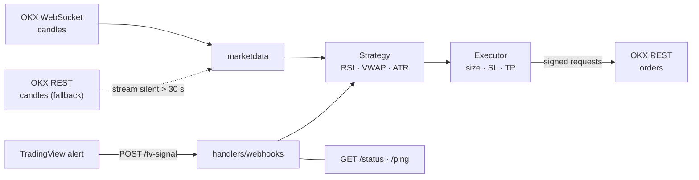
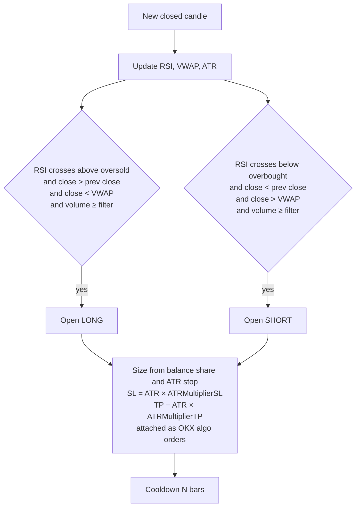

# OKX Trading Bot — RSI + VWAP strategy

An automated trading bot for the OKX exchange (perpetual swaps). It trades an **RSI + VWAP rejection** strategy with ATR-based position sizing, streams candles over WebSocket with a REST fallback, and also accepts TradingView signals over HTTP. Originally written in C#, then rewritten in Go.

> ⚠️ For educational purposes. Trading crypto derivatives carries a high risk of loss — test on a demo account first.

## Architecture



## Strategy



**Risk management**
- position size computed so that a configured share of the balance (`EquityPercent` / `RiskPercent`) is used with the stop at `ATR × multiplier` ("Pine mode", mirrors the original TradingView script); an all-in executor is available as an alternative
- stop loss and take profit at configurable ATR multiples (`ATRMultiplierSL`, `ATRMultiplierTP`), attached to the entry as OKX algo orders
- optional trailing stop with a dedicated trailing manager
- cooldown between signals to avoid overtrading

## Project structure

```
main.go                 — entry point: config, bot, HTTP server
bot/                    — trading loop and order executors
strategy/               — RSI + VWAP strategy, indicators, position sizing, trailing stops
client/okx_client.go    — OKX REST client (signed requests)
marketdata/websocket.go — OKX WebSocket market data
handlers/webhooks.go    — HTTP API: POST /tv-signal, GET /ping, GET /status
config/                 — configuration loading (appsettings.json)
Program.cs, botautotraide.cs — the original C# implementation
```

## Getting started

Requirements: Go 1.21+, an OKX account with API keys.

```bash
go mod tidy
# fill in API keys and strategy settings in appsettings.json
go run .
```

```json
{
  "OKX": {
    "ApiKey": "<api key>",
    "ApiSecret": "<api secret>",
    "Passphrase": "<passphrase>",
    "InstrumentId": "SOL-USDT-SWAP",
    "Timeframe": "15m"
  },
  "Strategy": {
    "RsiLength": 2,
    "RsiOverbought": 80,
    "RsiOversold": 20,
    "ATRLength": 14,
    "ATRMultiplierSL": 1.5,
    "ATRMultiplierTP": 1.5,
    "CooldownBars": 1,
    "RiskPercent": 2,
    "UseTrailingStop": false
  }
}
```

Docker: `docker compose up -d --build`. See [`README-Go.md`](README-Go.md), [`QUICK_START.md`](QUICK_START.md) and [`README-Deployment.md`](README-Deployment.md).
